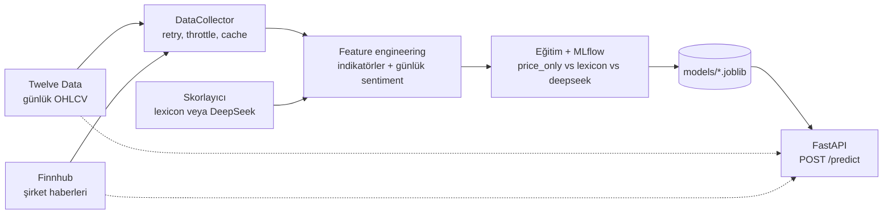

# Stock Direction Predictor


ABD borsası (NYSE/NASDAQ) hisseleri için **bir sonraki günlerde fiyatın yükselip yükselmeyeceğini** tahmin eden,
uçtan uca bir makine öğrenmesi mühendisliği projesi: veri toplama → feature engineering → MLflow ile kontrollü
deneyler → FastAPI ile servis → Docker ve CI/CD.

*End-to-end ML engineering project: market data + news sentiment → features → MLflow experiments → FastAPI → Docker/CI.*

> **Önemli:** Bu bir eğitim/portföy projesidir, **yatırım tavsiyesi değildir.** Hisse yönü tahmini son derece
> gürültülüdür; projenin asıl değeri tahmin başarısı değil, **doğru ve dürüst bir ML hattının** nasıl kurulduğudur
> (veri sızıntısına karşı önlemler, adil karşılaştırma, istatistiksel kontrol, servis ve dağıtım).
> Ayrıntılar için [Sınırlamalar ve dürüst notlar](#sınırlamalar-ve-dürüst-notlar) bölümüne bak.

## İçindekiler

- [Ne yapar?](#ne-yapar)
- [Mimari](#mimari)
- [Proje durumu](#proje-durumu)
- [Kurulum](#kurulum)
- [Hızlı başlangıç](#hızlı-başlangıç)
- [Dosya rehberi](#dosya-rehberi)
- [Hattın aşamaları ve komutlar](#hattın-aşamaları-ve-komutlar)
- [API referansı](#api-referansı)
- [Ortam değişkenleri](#ortam-değişkenleri)
- [Tasarım kararları](#tasarım-kararları)
- [Testler ve CI/CD](#testler-ve-cicd)
- [Sınırlamalar ve dürüst notlar](#sınırlamalar-ve-dürüst-notlar)
- [Yol haritası](#yol-haritası)
- [Sorun giderme](#sorun-giderme)

## Ne yapar?

1. **Veri toplar:** günlük fiyat verisini (OHLCV) [Twelve Data](https://twelvedata.com), şirket haberlerini
   [Finnhub](https://finnhub.io) üzerinden çeker; hız sınırı, yeniden deneme ve disk önbelleği yönetir.
2. **Feature üretir:** RSI, MACD, Bollinger, ATR, OBV, hareketli ortalamalar gibi teknik indikatörleri (hepsi
   pandas ile sıfırdan) ve haberlerden günlük **sentiment** feature'larını çıkarır. Sentiment iki yöntemle
   skorlanabilir: kelime listesi (**lexicon**) veya **DeepSeek** LLM'i.
3. **Kontrollü deney yapar:** `price_only` / `lexicon` / `deepseek` varyantlarını aynı veri ve aynı kronolojik
   bölmeyle eğitir, MLflow'a yazar ve *"sentiment fiyat feature'larının üstüne gerçekten bir şey katıyor mu?"*
   sorusunu bootstrap güven aralığıyla cevaplar.
4. **Servis eder:** eğitilmiş modeli FastAPI ile `POST /predict` olarak sunar. Canlı veriyi eğitimle **aynı
   kod yoluyla** işler.
5. **Paketler ve otomatikleştirir:** Docker imajları, `docker compose` ve GitHub Actions (test → imaj build →
   GHCR'a yayın).

## Mimari



Kesikli oklar, servisin tahmin anında **canlı** fiyat ve haber çektiğini gösterir. Eğitim ve servis aynı
`build_feature_dataset` ve `make_stationary_features` fonksiyonlarını kullanır.

## Proje durumu

| Durum | Konu |
|---|---|
| Tamamlandı | Veri toplama, feature engineering, günlük sentiment geçmişi, DeepSeek skorlayıcı |
| Tamamlandı | MLflow ile ablation (varyant karşılaştırması), model eğitimi |
| Tamamlandı | FastAPI servisi, Docker / docker compose, GitHub Actions CI |
| Doğrulandı | Testler sahte sağlayıcılarla ve sentetik veriyle geçiyor; gerçek API anahtarı gerektirmiyor |
| Henüz yapılmadı | Gerçek anahtarlarla uçtan uca koşu ve sonuçların yayınlanması, bulut (AWS) dağıtımı |

Geliştirme boyunca ağ erişimi olmayan bir ortamda sahte veri sağlayıcılarla çalışıldığı için **gerçek piyasa
verisiyle elde edilmiş bir sonuç bu depoda yoktur.** İlk gerçek koşu [yol haritasının](#yol-haritası) ilk maddesidir.

## Kurulum

### Önkoşullar

- **Python 3.12** (test edilen sürüm) ve `pip`
- **Twelve Data** API anahtarı (zorunlu) — <https://twelvedata.com> ücretsiz plan
- **Finnhub** API anahtarı (haber/sentiment için) — <https://finnhub.io> ücretsiz plan
- **DeepSeek** API anahtarı (*opsiyonel*, yalnızca LLM sentiment için) — <https://platform.deepseek.com>
- **Docker** ve Docker Compose (*opsiyonel*, konteyner çalıştırmak için)

> Ücretsiz plan limitleri zaman içinde değişebilir; güncel kotalar için sağlayıcıların fiyat sayfalarına bak.
> Pipeline, 429 (hız sınırı) yanıtlarında üstel bekleme ile yeniden dener ve çağrıları önbelleğe alır.

### Yerel kurulum

```bash
git clone https://github.com/your_username/stock-predictor.git
cd stock-predictor

python -m venv .venv
source .venv/bin/activate            # Windows (PowerShell): .venv\Scripts\Activate.ps1

pip install -r requirements.txt

cp .env.example .env                 # Windows (cmd): copy .env.example .env
# .env dosyasını aç ve your_* yazan değerleri kendi anahtarlarınla değiştir
```

`.env` dosyası **otomatik yüklenir** (python-dotenv ile); ayrıca `export` yapmana gerek yok. Gerçek ortam
değişkenleri `.env`'dekilerin önüne geçer. **`.env` dosyasını asla commit etme** (`.gitignore`'da zaten var).

### Bağımlılık dosyaları

| Dosya | Ne için |
|---|---|
| `requirements.txt` | Yerel geliştirme: her şey (eğitim, servis, test) |
| `requirements-serving.txt` | Yalnızca API'nin ihtiyaç duyduğu runtime bağımlılıkları (Docker `serving` imajı). `xgboost` yerine `xgboost-cpu` |
| `requirements-train.txt` | Runtime + MLflow, matplotlib, pytest (Docker `train` imajı ve CI) |

### Kurulumu anahtarsız doğrula

```bash
python -m pytest -q
```

Testler gerçek API'ye gitmez; bu komut, anahtarın olmadan da kurulumun sağlıklı olduğunu gösterir.

## Hızlı başlangıç

### A) Docker ile

```bash
cp .env.example .env                              # anahtarları doldur; API_AUTH_TOKEN için:
                                                  # python -c "import secrets; print(secrets.token_urlsafe(32))"

docker compose --profile train run --rm trainer   # topla → karşılaştır → feature → modeli eğit
docker compose up -d api                          # API: http://127.0.0.1:8000/docs
docker compose --profile ui up -d mlflow          # MLflow arayüzü: http://127.0.0.1:5000
```

### B) Yerel Python ile

```bash
python run_workflow.py                            # fiyat + haber topla, varyantları MLflow'da karşılaştır
python build_features_cli.py --scorer lexicon     # modelin eğitileceği feature dosyasını üret
python -m model_training.train                    # modeli eğit → models/xgboost_h1.joblib
uvicorn serving.app:app --port 8000               # API'yi başlat

mlflow ui --backend-store-uri sqlite:///mlflow.db # deneyleri incele
```

Tahmin istemek için:

```bash
curl -X POST http://127.0.0.1:8000/predict \
     -H "Content-Type: application/json" \
     -H "X-API-Key: your_api_auth_token" \
     -d '{"symbol": "AAPL"}'
```

## Dosya rehberi

```text
.
├── main.py                        # Veri toplama CLI'ı
├── build_features_cli.py          # Feature üretme CLI'ı
├── run_workflow.py                # Uçtan uca workflow (topla → haber → MLflow karşılaştırması)
├── data_pipeline/                 # Katman 1: veri toplama
├── feature_engineering/           # Katman 2: feature'lar ve sentiment
├── model_training/                # Katman 3: veri hazırlama, eğitim, deney
├── serving/                       # Katman 4: FastAPI servisi
├── tests/                         # Testler
├── Dockerfile, docker-compose.yml, .dockerignore
├── .github/workflows/ci.yml       # CI/CD
└── requirements*.txt, .env.example, .gitignore
```

### Kök dizindeki betikler

| Dosya | Görevi |
|---|---|
| `main.py` | Fiyat verisini toplar (`--news` ile haber geçmişini de). Çıktı: `data/processed/combined_dataset.csv`, `news_dataset.csv` |
| `build_features_cli.py` | Ham CSV'lerden model eğitimine hazır feature dosyasını üretir. `--scorer lexicon\|deepseek`, `--no-news`, `--horizon` |
| `run_workflow.py` | Tüm zinciri tek komutta çalıştırır; `--skip-collect` ile mevcut CSV'leri kullanır. Başarılıysa çıkış kodu 0 |

### `data_pipeline/` — veri toplama

| Dosya | Görevi |
|---|---|
| `config.py` | Ortam değişkenleri, `.env` yükleme, dosya yolları, varsayılan hisse listesi |
| `clients/base.py` | Ortak HTTP katmanı: yeniden deneme, üstel bekleme, istek aralığı (throttle), log'larda anahtar maskeleme |
| `clients/twelve_data_client.py` | Günlük OHLCV verisi |
| `clients/finnhub_client.py` | Şirket haberleri: tarih aralığı parçalama, kesilen sonuçları bölme, parça başına disk önbelleği |
| `clients/deepseek_client.py` | DeepSeek sohbet API'si (JSON modu) |
| `collector.py` | İstemcileri birleştirir; bir kaynak düşse bile pipeline durmaz (graceful degradation) |

### `feature_engineering/` — feature'lar

| Dosya | Görevi |
|---|---|
| `technical_indicators.py` | SMA/EMA, RSI, MACD, Bollinger, ATR, OBV, hacim, momentum (sıfırdan pandas) |
| `sentiment_features.py` | Lexicon skorlayıcı, haberleri **doğru işlem gününe hizalama**, günlük toplulaştırma, rolling sentiment |
| `llm_sentiment.py` | DeepSeek tabanlı skorlayıcı: toplu istek, disk önbelleği, hata durumunda lexicon'a düşme |
| `build_features.py` | Çoklu sembol orkestrasyonu: indikatör + sentiment + hedef (`target_direction_Nd`) |

### `model_training/` — eğitim ve deney

| Dosya | Görevi |
|---|---|
| `dataset.py` | Fiyat seviyesinden bağımsız (stationary) feature'lar, **kronolojik** train/val/test bölmesi, servis için tek satırlık feature üretimi |
| `train.py` | "Hep yükselir" referansı, Logistic Regression ve XGBoost eğitimi; MLflow'a loglama; modeli metadata ile `models/`'e kaydetme |
| `experiment.py` | `price_only` / `lexicon` / `deepseek` karşılaştırması: çok seed'li eğitim, tarih-bloklu bootstrap güven aralığı, rapor |

### `serving/` — API

| Dosya | Görevi |
|---|---|
| `app.py` | FastAPI uygulaması: `/health`, `/model`, `/predict`, isteğe bağlı API anahtarı koruması |
| `feature_service.py` | Canlı veriden feature satırı: yarım gün barını atma, önbellek, haber hatasında nötr sentiment |
| `model_store.py` | Eğitilmiş modeli (joblib) ve metadata'sını yükler |
| `schemas.py` | İstek/cevap şemaları ve sembol doğrulaması |
| `settings.py` | Ortam değişkenlerinden servis ayarları |

### `tests/` — testler

| Dosya | Ne doğrular |
|---|---|
| `test_sentiment_history.py` | Haber–işlem günü hizalaması (saat dilimi, yaz saati, hafta sonu), parçalı çekme, önbellek, sızıntı yok |
| `test_llm_sentiment.py` | DeepSeek skorlayıcı (sahte istemciyle): toplu istek, önbellek, geçersiz yanıt, devre kesici, log maskeleme |
| `test_experiment.py` | MLflow karşılaştırması, bootstrap, bozuk/eksik varyantların atlanması |
| `test_serving.py` | API uçları, hata kodları, yetkilendirme, önbellek, yarım bar ve **eğitim–servis feature eşitliği** |
| `test_cli.py` | `build_features_cli.py` akışı |
| `test_deploy_config.py` | Dockerfile / compose / CI dosyalarının güvenlik ve tutarlılık kontrolleri, `.env` yükleme |
| `test_docs.py` | README'deki dosya adları, bağlantılar ve komut bayrakları kodla uyumlu mu |

## Hattın aşamaları ve komutlar

| Aşama | Komut | Çıktı |
|---|---|---|
| 1. Veri topla | `python main.py --news` | `data/processed/combined_dataset.csv`, `news_dataset.csv` |
| 2. Feature üret | `python build_features_cli.py --scorer lexicon` | `data/processed/features_dataset.csv` |
| 3. Deney | `python -m model_training.experiment --variants price_only lexicon deepseek --seeds 3` | MLflow parent run + `comparison.md/.csv` |
| 4. Model eğit | `python -m model_training.train --horizon 1` | `models/xgboost_h1.joblib` |
| 5. Servis | `uvicorn serving.app:app --port 8000` | `http://127.0.0.1:8000/docs` |

`run_workflow.py` 1. ve 3. aşamayı tek komutta yapar. Başlıca bayraklar:

```bash
python run_workflow.py --skip-collect                # API'ye gitmeden mevcut CSV'lerle deney
python run_workflow.py --no-news                     # sadece fiyat (price_only)
python run_workflow.py --variants price_only lexicon --seeds 5
python main.py --tickers AAPL MSFT NVDA --lookback 365 --news
python build_features_cli.py --no-news               # price_only feature seti ile model eğitmek için
```

### Deney sonucunu nasıl okumalı?

`comparison.md` her varyant için test AUC'sini (± seed std), referansa göre farkı ve **%95 güven aralığını**
verir. Aralık 0'ı içeriyorsa sonuç **"ayırt edilemez"** olarak işaretlenir: kâğıt üstünde daha yüksek görünen bir
AUC bile gürültüden ayırt edilemeyebilir. `price_only` en iyi/eşitse, modeli
`python build_features_cli.py --no-news` ile eğit; sentiment kazanıyorsa varsayılan akışı kullan ve servisteki
`SENTIMENT_SCORER`'ın eğitimdekiyle aynı olduğundan emin ol.

### Haber–işlem günü hizalaması

Bir günün feature satırı o günün kapanışında (16:00 ET) bilinebilecek bilgiyle hesaplanır:

| Haber zamanı (New York) | Girdiği feature satırı |
|---|---|
| Salı 14:30 | Salı |
| Salı 16:30 | Çarşamba |
| Cuma 18:00 veya hafta sonu / tatil | Sonraki işlem günü (Pazartesi) |

## API referansı

Etkileşimli dokümantasyon: `http://127.0.0.1:8000/docs`

| Uç | Açıklama | Yetki |
|---|---|---|
| `GET /health` | Canlılık ve model yüklü mü | yok |
| `GET /model` | Eğitim tarihi, eğitimde görülen semboller, test metrikleri | `X-API-Key` |
| `POST /predict` | `{"symbol": "AAPL"}` → yükseliş olasılığı | `X-API-Key` |

`API_AUTH_TOKEN` boşsa yetkilendirme kapalıdır (yalnızca yerel geliştirme için).

Örnek cevap:

```json
{
  "symbol": "AAPL",
  "as_of": "2026-11-06",
  "horizon_days": 1,
  "probability_up": 0.53,
  "predicted_direction": "up",
  "threshold": 0.5,
  "sentiment_used": true,
  "symbol_in_training_set": true,
  "warnings": [],
  "model": { "name": "xgboost_h1", "trained_at": "2026-11-07T12:35:14+00:00" }
}
```

| Kod | Anlamı |
|---|---|
| 200 | Başarılı |
| 401 | `X-API-Key` eksik veya yanlış |
| 422 | Geçersiz sembol biçimi veya sembol için yeterli geçmiş yok |
| 502 | Fiyat verisi alınamadı (bilinmeyen sembol, sağlayıcı sorunu ya da geçersiz anahtar) |
| 503 | Model yüklü değil (`/health` "degraded" gösterir) |

## Ortam değişkenleri

`.env.example` dosyasını kopyala. Tüm değerler yer tutucudur (`your_*`).

| Değişken | Zorunlu | Açıklama |
|---|---|---|
| `TWELVE_DATA_API_KEY` | evet | Fiyat verisi |
| `FINNHUB_API_KEY` | haber için | Şirket haberleri |
| `DEEPSEEK_API_KEY` | hayır | LLM sentiment; yoksa `deepseek` varyantı atlanır |
| `DEEPSEEK_MODEL` / `DEEPSEEK_BASE_URL` | hayır | Model adı değişirse güncelle (varsayılan `deepseek-flash`) |
| `API_AUTH_TOKEN` | servis için önerilir | Doluysa `/predict` ve `/model` için `X-API-Key` zorunlu |
| `SENTIMENT_SCORER` | hayır | `lexicon` veya `deepseek`; **modelin eğitildiği skorlayıcıyla aynı olmalı** |
| `MODEL_PATH` | hayır | Yüklenecek model (varsayılan `models/xgboost_h1.joblib`) |
| `FEATURE_CACHE_TTL_SECONDS` | hayır | Sembol başına canlı feature önbellek süresi (varsayılan 3600) |
| `MLFLOW_TRACKING_URI` | hayır | Varsayılan: proje dizininde SQLite (`mlflow.db`) |
| `API_BIND`, `MODELS_DIR` | hayır | Yalnızca docker compose: API'nin bağlanacağı adres, yerel model klasörü |

## Tasarım kararları

**Veri sızıntısına (look-ahead) karşı**
- Train/val/test **kronolojiktir** (shuffle yok); aralarında tahmin ufku kadar boşluk bırakılır.
- Son satırların hedefi (gelecek yok) `NaN` kalır ve atılır; "düşüş" etiketiyle sessizce doldurulmaz.
- Haberler yalnızca kapanışta bilinebilecekleri işlem gününe yazılır (yukarıdaki tablo).
- Fiyat seviyesine bağlı feature'lar (SMA, Bollinger, ATR...) kapanışa oranlanır; model fiyatı ezberlemez.
- Sembol içinde değişmeyen feature'lar elenir; aksi halde modele gizlice "hangi hisse" bilgisi sızar.

**Adil karşılaştırma**
- Varyantlar aynı veri, aynı bölme ve aynı model ayarıyla eğitilir; test satırları aynı değilse koşucu hata verir.
- XGBoost çok seed ile eğitilir; fark için **tarih-bloklu bootstrap** kullanılır (aynı gün farklı hisseler birlikte
  örneklenir, böylece satır bazlı bootstrap'in verdiği sahte güven oluşmaz).
- LLM varyantında haberlerin %10'undan fazlası lexicon'a düşerse run `degraded` etiketlenir; API anahtarı yoksa
  varyant hiç çalıştırılmaz.

**Servis**
- Eğitim ve servis aynı feature kodunu kullanır; bir test, ikisinin aynı vektörü ürettiğini doğrular.
- İşlem günü sürerken sağlayıcının döndürebileceği tamamlanmamış günlük bar atılır.
- Sembol başına önbellek ve eşzamanlı istekleri tekilleştirme, ücretsiz API kotasını korur.
- Model yoksa servis ayakta kalır (`/health` = degraded); haber alınamazsa sentiment nötr sayılır ve cevapta uyarı çıkar.

**Güvenlik**
- Anahtarlar yalnızca ortam değişkenlerinden okunur; hata log'larında maskelenir; `.dockerignore` `.env`'i imajdan dışarıda tutar.
- Sembol, dış API'ye gitmeden önce sıkı bir regex ile doğrulanır. Haber metni güvenilmeyen veri sayılır; LLM
  çıktısı doğrulanır ve [-1, 1] aralığına kırpılır.
- Konteyner root olmayan kullanıcıyla çalışır; varsayılan olarak yalnızca `127.0.0.1`'e açılır.
- `joblib` dosyaları keyfi kod çalıştırabilir: **yalnızca kendi eğittiğin modelleri yükle.** Yol sadece ortam
  değişkeninden gelir, istekten asla.

## Testler ve CI/CD

```bash
python -m pytest -q                       # tüm testler
python -m pytest tests/test_serving.py    # tek dosya
```

Testler gerçek ağa çıkmaz ve API anahtarı gerektirmez; sağlayıcılar sahte nesnelerle değiştirilir.

GitHub Actions (`.github/workflows/ci.yml`):

1. **test** — bağımlılıkları kurar, `pytest` çalıştırır.
2. **docker** — `serving` imajını build eder; konteyneri başlatır, `/health` cevabını, root olmayan kullanıcıyı ve
   bağımlılıkların yeterliliğini doğrular.
3. **publish** — yalnızca `main`'e push'ta imajı `ghcr.io/<kullanıcı>/<repo>/api` adresine `latest` ve commit SHA
   etiketleriyle gönderir. İşler varsayılan olarak salt-okunur izinle çalışır; yazma yetkisi yalnızca bu işte vardır.

Docker hedefleri: `serving` (küçük, yalnızca runtime) ve `train` (MLflow ve test araçlarıyla). Eğitim ve servis
aynı sabit kütüphane sürümleriyle çalışsın diye model varsayılan olarak `train` imajında eğitilir (pickle dosyaları
scikit-learn/xgboost sürümüne duyarlıdır). Yerelde eğittiğin modeli kullanmak için:
`MODELS_DIR=./models docker compose up -d api`.

## Sınırlamalar ve dürüst notlar

- **Beklenen performans düşüktür.** Günlük hisse yönü tahmininde test AUC'sinin 0.50–0.55 civarında kalması
  normaldir. Bu projede önemli olan, modelin "hep yükselir" referansını **tutarlı ve istatistiksel olarak anlamlı**
  biçimde geçip geçmediğidir; geçmiyorsa sonuç "ayırt edilemez" diye raporlanır.
- **Az hisse, tek test dönemi.** Varsayılan 5 hisse istatistiksel güç için azdır; aralıklar geniş çıkabilir.
- **LLM look-ahead riski.** Prompt "sadece metne bak" der, ancak model geçmiş olayların sonuçlarını eğitim
  verisinden bilebilir; bu risk tamamen ortadan kalkmaz. Geçmişteki bir LLM üstünlüğü canlıda da geçerli olacak
  anlamına gelmez.
- **Lexicon küçüktür.** Gerçek başlıkların büyük kısmı nötr (0) çıkabilir.
- **Ücretsiz plan kotaları dardır.** Haber geçmişinin ilk çekimi yavaştır (yaklaşık 1 istek/sn); sonrası önbellekten gelir.
- **Backtest yok.** `train.py` içindeki "sinyal getirisi" işlem maliyeti ve kayma içermez; yalnızca yön sezgisi verir.
- Bu yazılım yatırım kararlarında kullanılmamalıdır.

## Yol haritası

- [x] Veri toplama: yeniden deneme, hız sınırı, önbellek, graceful degradation
- [x] Teknik indikatörler ve stationary feature'lar
- [x] Günlük haber sentiment geçmişi ve işlem günü hizalaması
- [x] DeepSeek tabanlı sentiment skorlayıcı
- [x] MLflow ile ablation (`price_only` / `lexicon` / `deepseek`) ve bootstrap güven aralığı
- [x] FastAPI servisi (önbellek, yetkilendirme, eğitim–servis eşitliği testi)
- [x] Docker, docker compose, GitHub Actions CI ve GHCR yayını
- [ ] **Gerçek anahtarlarla ilk uçtan uca koşu** ve sonuç tablosunun bu README'ye eklenmesi
- [ ] Daha geniş hisse evreni (örn. S&P 100) ve farklı tahmin ufukları
- [ ] AWS free tier (EC2) üzerinde dağıtım, TLS'li ters vekil
- [ ] Zamanlanmış yeniden eğitim (GitHub Actions `schedule` veya cron)
- [ ] MLflow Model Registry ile en iyi varyantın otomatik terfisi
- [ ] Tahmin loglama ve veri kayması (drift) izleme
- [ ] İşlem maliyetli gerçekçi backtest
- [ ] Zamansal modeller (LSTM) denemesi
- [ ] `LICENSE` dosyası

## Sorun giderme

<details>
<summary><b>ModuleNotFoundError: No module named 'data_pipeline'</b></summary>

Komutları proje kök dizininden çalıştır (`python -m ...` ve `python main.py` kökten çalışır).
</details>

<details>
<summary><b>API anahtarı tanımlı değil / "fiyat verisi alınamadı"</b></summary>

`.env` dosyasının proje kökünde olduğunu ve `your_*` yer tutucularını değiştirdiğini kontrol et. Anahtarlar
log'larda maskelenir; yanlış anahtarda sağlayıcı 401/403 döner ve ilgili sembol atlanır.
</details>

<details>
<summary><b>429 / günlük kota doldu</b></summary>

Pipeline üstel bekleme ile yeniden dener. Kota bittiyse hisse sayısını (`--tickers`) veya `--lookback`'i azalt,
yarın tekrar dene. Haber parçaları `data/cache/` altında önbelleklenir; tekrar çalıştırmada yeniden çekilmez.
</details>

<details>
<summary><b>Finnhub haber sentiment'i 403 döndürüyor</b></summary>

Hazır `news-sentiment` uç noktası ücretsiz planda kısıtlı olabilir. Proje buna bağımlı değildir: günlük sentiment,
`company-news` başlıklarından kendi skorlayıcımızla üretilir; hazır skor alınamazsa nötr değerle devam edilir.
</details>

<details>
<summary><b>MLflow "file store" hatası</b></summary>

Yeni MLflow sürümleri dosya tabanlı depolamayı reddeder. Proje SQLite kullanır; `MLFLOW_TRACKING_URI`'yi
elle veriyorsan `sqlite:///...` biçiminde ver.
</details>

<details>
<summary><b>/predict 503 veya /health "degraded"</b></summary>

Model dosyası yok. Önce `python -m model_training.train` çalıştır (Docker'da `trainer` servisini). `MODEL_PATH`'i kontrol et.
</details>

<details>
<summary><b>/predict 502</b></summary>

Sembol bilinmiyor olabilir veya sağlayıcıya erişilemiyor / anahtar geçersiz. Yerel testte sembolü `AAPL` gibi
yaygın bir hisseyle dene.
</details>

<details>
<summary><b>Docker: eğitilen model API'de yüklenmiyor</b></summary>

Yerelde eğittiğin model ile imajdaki kütüphane sürümleri farklıysa pickle yüklenemez. Modeli `train` imajında
eğit (`docker compose --profile train run --rm trainer`) veya yerel sürümleri `requirements-serving.txt` ile hizala.
</details>

---

*Bu proje eğitim amaçlıdır ve finansal tavsiye niteliği taşımaz.*
